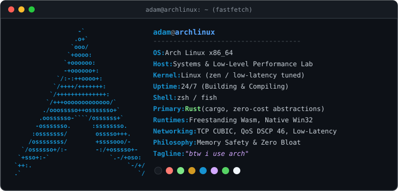

  <h1>Adam · s3amm3r</h1>
  
<b>Systems Programmer · Low-Level Windows Performance · WebAssembly</b>

   

  

    

  <!-- Skill Icons -->
  

    

  <!-- Connect Badges -->
  
  &nbsp;
  

 

---

### ⚙️ Focus & Systems Stack

- **Systems & Memory Safety:** Idiomatic Rust (`cargo`, native performance, zero-cost abstractions)
- **WebAssembly:** Freestanding Wasm runtime architectures
- **Windows Internals & Networking:** Win32, TCP stack & QoS DSCP 46 optimization, kernel latency stripping
